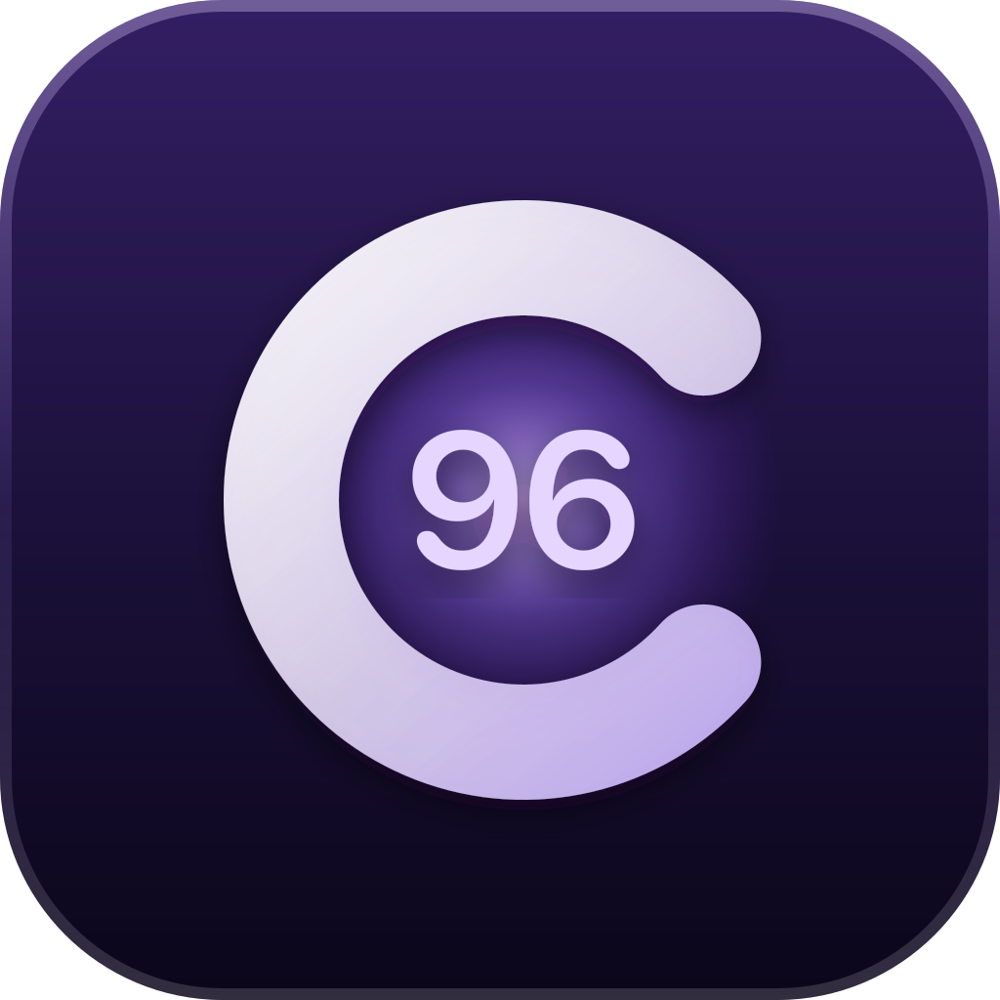
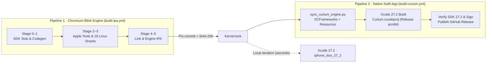

<div align="center">
  
  <h1>Curium · 96 Cm</h1>
  <p><strong>A native iOS Liquid Glass browser powered by embedded Chromium Blink, V8, Manifest V3 extensions, and isolated fingerprint profiles.</strong></p>

  <p>
    <a href="https://github.com/benjipeng/curium/releases/latest"></a>
    <a href="https://github.com/benjipeng/curium/actions/workflows/build-curium.yml"></a>
    <a href="https://github.com/benjipeng/curium/actions/workflows/build-ipa.yml"></a>
    
    
    <a href="LICENSE"></a>
  </p>

  <p>
    <a href="https://github.com/benjipeng/curium/releases/latest">Download IPA</a> ·
    <a href="#install--sideload">Install Guide</a> ·
    <a href="#fingerprint--profile-isolation">Fingerprint Studio</a> ·
    <a href="#dual-pipeline-architecture">Architecture</a> ·
    <a href="Curium/README.md">App Guide</a> ·
    <a href="EngineContract/README.md">Engine Contract</a>
  </p>
</div>

---

Curium (`com.appautomaton.curium`) pairs a pure Swift / SwiftUI Liquid Glass shell with a real single-process Chromium engine — **Blink, V8, and Manifest V3 extensions** — with zero Google chrome, zero telemetry services, and zero WebKit fallback.

One repository and one integration branch (`main`) hold both pipelines: **GitHub Actions** cross-compiles and links Chromium without a local checkout, while **Xcode 27.2** builds and iterates on the native Swift browser locally in seconds against the prebuilt engine pinned in [`Kernel.lock`](Kernel.lock).

## Highlights

| Capability | What Curium Ships |
| --- | --- |
| **Real Chromium Blink + V8** | Upstream Chromium `160.0.8171.0` running single-process for iOS and LiveContainer. Runs jitless with DrumBrake Wasm by default and switches automatically to V8 JIT (TXM Split-W^X / native `MAP_JIT`) when attached via StikDebug. |
| **Native iOS 27.2 & Liquid Glass** | Linked against iPhoneOS `27.2` SDK with adaptive foldable dual-display chrome, `84 pt` system vertical bars, `.division` hinge clearance, 120 Hz ProMotion scroll collapsing, zero-copy Picture in Picture, and hardware VP9 decode. |
| **Manifest V3 Extensions** | Install directly from the Chrome Web Store or signed `.crx` files with native permission review, action badges, unclipped extension popups, and full single-process coexistence (e.g. **uBlock Origin Lite** + **Dark Reader** together). |
| **Fingerprint Studio & Profile Isolation** | Pre-`ChromeMain` launch-scoped identity contract (`Build 40`) with isolated per-profile storage containers (Cookies, `localStorage`, `IndexedDB`, `CacheStorage`, HTTP cache), 7 built-in presets, native Apple Silicon hardware by default, opt-in hardware/GPU/timezone overrides, 3-way proxy policy, Zstd transport baseline, and DNT / Sec-GPC support. |
| **Zero-Local-Checkout CI** | Dual GitHub Actions pipelines with write-once GHCR checkpoints across 18 parallel Linux cross-compile shards. Iterating on Swift UI, presets, or shell hooks keeps **100% of Chromium build checkpoints reusable**. |

## Install & Sideload

Prebuilt ad-hoc signed `arm64` IPAs are published on [**GitHub Releases**](https://github.com/benjipeng/curium/releases/latest) alongside SHA-256 checksums.

1. Download `Curium-<version>-b<build>-arm64.ipa` from the latest release.
2. **LiveContainer (recommended for non-jailbroken iOS 26/27):**
   - Import the IPA into LiveContainer (replacing an existing `com.appautomaton.curium` install preserves user data).
   - Durable bookmarks, history, fingerprint profiles, and diagnostics live outside the volatile guest container (`Library/Application Support/Curium/`), and downloads save to `Documents/Curium/Downloads/`.
   - **Optional V8 JIT:** Enable **Launch with JIT** in LiveContainer with StikDebug's `universal.js`. Without a debugger, Curium safely falls back to jitless mode.
3. **AltStore / SideStore / Xcode:** Sign with your own team and install on iOS 26.0+ (`iOS 27.2` recommended for native Liquid Glass and dual-display chrome).

## Fingerprint & Profile Isolation

Curium's Build 40 engine contract exposes a capability-probed, write-once-before-`ChromeMain` launch configuration (`schemaVersion: 1`, `<= 64 KiB`) managed in **Settings → Browser Identity & Profile → Manage Profiles & Fingerprints**:

- **Strict cold-launch isolation:** `"default"` keeps legacy `Chromium/` storage; every named profile binds its own `<Application Support>/ChromiumProfiles/<id>` and `<Caches>/ChromiumProfiles/<id>` protected by an advisory `flock` lock and symlink checks. Invalid or unavailable explicit profiles **fail closed** to a native recovery screen rather than silently opening the default cookie jar.
- **Authentic Apple hardware by default:** Unset hardware, timezone, input, and WebGL fields incur zero runtime overhead and preserve genuine Apple Silicon + Metal GPU strings. Opt-in overrides apply cleanly across both Window and Worker contexts.
- **Network & frame coherence:** Baseline HTTPS `zstd` negotiation and decode (`Range` excluded), fixed-proxy fail-closed routing (with one-tap `<-loopback>` support), WebRTC IP handling policies, `DNT: 1` / `Sec-GPC: 1`, and consistent Desktop identity inheritance across cross-origin OOPIF iframes, nested `about:blank`/`srcdoc`, and synchronous `window.open('')`.

| Built-In Preset | Default Slot | Identity | Hardware / GPU |
| --- | --- | --- | --- |
| `default` | Mobile (Dual-Slot) | Android 15 Chrome / macOS arm64 Chrome | Native Apple HW & Metal GPU |
| `ios-blink` | Mobile (Dual-Slot) | iOS 18_7 mobile / macOS Desktop | Native Apple HW & Metal GPU |
| `macos-desktop` | Desktop-First | macOS arm64 Chrome (incl. Workers) | Native Apple HW & Metal GPU |
| `win11-workstation` | Desktop-First | Windows 11 x64 Chrome | Opt-in 8c / 8 GB / Intel Iris Xe D3D11 |
| `linux-desktop` | Desktop-First | Linux x86_64 Chrome | Opt-in 8c / 8 GB / Mesa Intel OpenGL |
| `pixel-android` | Mobile (Dual-Slot) | Pixel 9 Android 15 Reduced UA / macOS | Native Apple HW (8 GB Android cap) |
| `privacy-hardened` | Mobile (Dual-Slot) | Authentic Chrome · Non-proxied UDP off · GPC on | Native Apple HW & Metal GPU |

Adding, duplicating, importing, or exporting profiles happens entirely in Swift / JSON — no Chromium rebuild required.

## Dual-Pipeline Architecture



### Engine Build Stages (`build-ipa.yml`)

The remote engine build uses a pruned, revision-pinned source snapshot from `sync-source.yml` stored in GHCR. Linux cross-compiles `arm64` iOS objects with `ld64.lld`; macOS supplies the pinned Apple tools and packages the output.

| Stage | Runner | Work |
| --- | --- | --- |
| 0 · SDK stub | macOS | Extract the iPhoneOS SDK and Swift stub from the Xcode pinned in `version.lock`; publish the encrypted artifact. |
| 1 · Codegen | Linux | Apply `patches/series`, generate and audit the Ninja graph, and build host tools and generated inputs. |
| 2 · Apple tools | macOS | Run Apple-only edges for Swift, asset catalogs, interface files, and App Intents. |
| 3 · Compile | Linux | Build target objects across 18 stable partitions in parallel, each with its own `ccache` bucket. |
| 4 · Link | Linux | Verify partition manifests and object hashes, then link `Chromium.app` and save unstripped symbols. |
| 5 · Package | macOS | Extract deferred AppIntents metadata, verify stripped ObjC ABI exports, prune stubs, sign, and publish the engine IPA. |

## Local App & Engine Handoff

Open `Curium.xcodeproj` in Xcode 27.2 on Apple silicon and select the `Curium` scheme. The Swift shell in `Curium/` links against the Objective-C contract in [`EngineContract/`](EngineContract/README.md) and consumes the device or simulator slice assembled into `Vendor/CuriumEngine/`.

```sh
# 1. Assemble and SHA-256 verify the Chromium Blink engine pinned in Kernel.lock
python3 scripts/sync_curium_engine.py
python3 scripts/sync_curium_engine.py --status

# 2. Run unit tests (standby shell, no engine required)
unset SDKROOT
xcodebuild -project Curium.xcodeproj -scheme Curium \
  -destination 'platform=iOS Simulator,name=iPhone 16 Pro' \
  CURIUM_USE_ENGINE_XCFRAMEWORK=NO test

# 3. Package an ad-hoc signed Release arm64 IPA locally
./scripts/build_curium_ipa.sh --output-dir dist
```

- [`Kernel.lock`](Kernel.lock) is the single source of truth for the pinned engine (commit, Actions run, artifact ID, Chromium version, ZIP and IPA SHA-256 digests). Update it only from a verified `build-ipa.yml` package.
- Set `CURIUM_USE_ENGINE_XCFRAMEWORK = YES` in [`Version.xcconfig`](Version.xcconfig) to link Blink, or `NO` to build the standby shell for fast UI iteration and unit testing.
- See [`Curium/README.md`](Curium/README.md) for app architecture and [`docs/simulator.md`](docs/simulator.md) for standalone Chromium IPA diagnostics.

## Checkpoints & CI Cache Reuse Rules

Pipeline 1 plans before compiling and reuses write-once GHCR checkpoints for codegen, Apple tools, all 18 compile shards, and link. Keys derive from stage epochs (`ci/epochs.json`), upstream keys, source and SDK digests, and the classified inputs in [`scripts/plan_pipeline.py`](scripts/plan_pipeline.py).

- **Keep Swift work 100% cache-free:** Leaving `patches/`, `args/`, `version.lock`, and `plan_pipeline.py`'s `COMMON` files untouched keeps **every GHCR engine checkpoint reusable** across Swift, UI, and release iterations.
- **Gate engine waves before building:** Batch C++ changes into `patches/`, validate patch application locally with `scripts/check_remote_patches.py --local-excerpts`, run `graph-diagnose.yml` (with `compile_extensions=true` to `-Werror`-probe touched `.o` files without linking), then run `build-ipa.yml` and repin `Kernel.lock` after Simulator verification.

## Repository Setup (Forks / Self-Hosting)

1. Use a public GitHub repository and set the `CI_ARTIFACT_KEY` secret for encrypted SDK stub artifacts.
2. Run `sync-source.yml` to cache the pruned Chromium source snapshot for the revision in `version.lock`.
3. Run `build-ipa.yml` (Pipeline 1) to produce the verified engine IPA, then update `Kernel.lock`.
4. Push a `curium-v*` tag or dispatch `build-curium.yml` (Pipeline 2) to build and publish the Curium IPA to GitHub Releases.

## Repository Layout

| Path | Purpose |
| --- | --- |
| `Curium/`, `Curium.xcodeproj` | Native Swift / Liquid Glass browser shell, Fingerprint Studio, and Xcode project. |
| `CuriumTests/` | Swift Testing unit test suites (layout, SQLite WAL, diagnostics, fingerprint validation & storage safety). |
| `EngineContract/` | Versioned Objective-C Clang module defining the shell ↔ Blink engine ABI. |
| `Kernel.lock`, `Version.xcconfig` | Pinned Chromium Blink engine provenance and Curium release version/build numbers. |
| `patches/`, `args/`, `version.lock` | Upstream Chromium revision pin, ordered patch series (`0001`–`0106`), and GN configuration. |
| `scripts/`, `ci/`, `.github/workflows/` | Dual-pipeline CI orchestration, GHCR checkpoint planner, local engine sync, and IPA packager. |
| `docs/`, `tools/simulator/` | App icon assets, simulator diagnostics, and historical research memos. |
