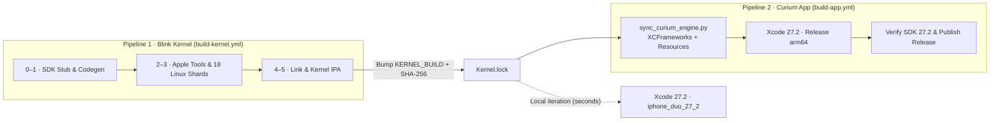

<div align="center">
  
  <h1>Curium · 96 Cm</h1>
  <p><strong>A native iOS Liquid Glass browser powered by embedded Chromium Blink, V8, Manifest V3 extensions, and zero-restart isolated profiles.</strong></p>

  <p>
    <a href="https://github.com/benjipeng/curium/releases/latest"></a>
    <a href="https://github.com/benjipeng/curium/actions/workflows/build-app.yml"></a>
    <a href="https://github.com/benjipeng/curium/actions/workflows/build-kernel.yml"></a>
    
    
    <a href="LICENSE"></a>
  </p>

  <p>
    <a href="https://github.com/benjipeng/curium/releases/latest">Download IPA</a> ·
    <a href="#install--sideload">Install</a> ·
    <a href="#profiles--privacy">Profiles &amp; Privacy</a> ·
    <a href="#dual-pipeline-architecture">Architecture</a> ·
    <a href="Curium/README.md">App Guide</a> ·
    <a href="EngineContract/README.md">Engine Contract</a>
  </p>
</div>

---

Curium (`com.appautomaton.curium`) wraps a real single-process Chromium kernel in a pure Swift / SwiftUI Liquid Glass shell — zero Google UI, zero telemetry services, and zero WebKit fallback.

One repository on `main` drives two decoupled tracks with independent build numbers: **GitHub Actions** cross-compiles and links the Chromium kernel ([`Kernel.lock`](Kernel.lock), monotonic `KERNEL_BUILD`), while **Xcode 27.2** builds and ships the native Swift app ([`Version.xcconfig`](Version.xcconfig)) in seconds against the pinned kernel.

## Highlights

| Capability | What Curium Ships |
| --- | --- |
| **Chromium Blink + V8** | Upstream Chromium `160.0.8171.0` running single-process for iOS and LiveContainer. Runs jitless with DrumBrake Wasm by default and enables V8 JIT automatically (TXM Split-W^X / native `MAP_JIT`) when attached via StikDebug. |
| **Native iOS 27.2 & Liquid Glass** | Linked against iPhoneOS `27.2` SDK with iPhone Duo `.division` fold adaptation, `84 pt` vertical bars, 120 Hz ProMotion scroll collapsing, zero-copy Picture in Picture, inline `PDFKit` preview, and hardware VP9 decode. |
| **Manifest V3 Extensions** | Install from the Chrome Web Store or signed `.crx` files with native permission review, action badges, unclipped popups, and full single-process coexistence (e.g. **uBlock Origin Lite** + **Dark Reader** together). |
| **Profiles & Hot-Swap Privacy** | Zero-restart profile hot-swap (`EngineContract` v4), live per-tab farbling & privacy toggles, isolated profile storage, and coherent Apple Silicon M1–M5 macOS desktop personas. |
| **Multi-Lane Range & HLS Transfers** | Chromium-native `CrIOSNetworkFetchV1` zero-probe streaming, 8–16 lane HTTP `206` work-stealing, pure-Swift HLS→MP4 remuxing, fail-closed proxy routing, and signature-checked Refresh-URL resume. |

## Install & Sideload

Ad-hoc signed `arm64` IPAs and `.sha256` checksums are published on [**GitHub Releases**](https://github.com/benjipeng/curium/releases/latest).

1. Download `Curium-<version>-b<build>-arm64.ipa` from the latest release.
2. **LiveContainer (recommended on non-jailbroken iOS 26/27):** Import the IPA (`com.appautomaton.curium`; overwriting preserves user data). Durable library, profiles, and logs live in `Library/Application Support/Curium/`; downloads save to `Documents/Curium/Downloads/`. Enable **Launch with JIT** with StikDebug's `universal.js` for optional V8 JIT.
3. **AltStore / SideStore / Xcode:** Re-sign with your team and install on iOS 26.0+ (`iOS 27.2` recommended for native Liquid Glass and dual-display chrome).

## Profiles & Privacy

Managed in **Settings → Profile**, Curium keeps `"default"` in `<Application Support>/Chromium` and binds each named profile to an isolated `<Application Support>/ChromiumProfiles/<id>` root protected by `flock` locks and symlink checks (missing or invalid explicit profiles fail closed to a native recovery screen).

- **Zero-restart hot-swap (`EngineContract` v4):** Switching profiles quiesces outgoing tabs/fetches/extensions, tears down the outgoing `ProfileIOS`, swaps process-scoped CoreText macOS font suites, and boots the target profile in the same process.
- **Live runtime privacy policy (`policySchemaVersion: 1`):** Toggle Canvas/Audio/WebGL/TextMetrics farbling, WebRTC IP policy, `DNT`, `Sec-GPC`, and speech voice hiding across open tabs with zero restart.
- **Coherent Apple Silicon personas:** `macos-desktop`, `privacy-hardened`, and migrated `default` profiles ship on an Apple M3 macOS Chrome 158 baseline (native Apple Metal `webglProfile`, selectable M1–M5 variants, custom screen/timezone, and fail-closed proxy routing).

## Dual-Pipeline Architecture



| Stage | Runner | Responsibility |
| --- | --- | --- |
| `0` · SDK stub | macOS | Extract the pinned iPhoneOS SDK and Swift stub (`version.lock`) into an encrypted artifact. |
| `1` · Codegen | Linux | Apply `patches/series`, audit the Ninja graph, build host tools, and publish the incremental graph index. |
| `2` · Apple tools | macOS | Execute Apple-only edges (Swift, asset catalogs, interface files, App Intents). |
| `3` · Compile | Linux | Cross-compile `arm64` objects across 18 stable shards with per-shard `ccache` and fail-closed `.cc`/`.mm` incremental reuse. |
| `4` · Link | Linux | Verify every shard manifest and object digest, link `Chromium.app` with `ld64.lld`, and archive symbols. |
| `5` · Package | macOS | Extract AppIntents metadata, verify exported ObjC ABI, sign, and publish the kernel IPA. |

**CI Cache Rules:** Write-once GHCR checkpoints are keyed by `ci/epochs.json`, `version.lock`, `patches/`, `args/`, and the `COMMON` scripts classified in [`scripts/plan_pipeline.py`](scripts/plan_pipeline.py). Swift/UI/release edits are **100% cache-free**; pure `.cc`/`.mm` patch edits rebuild only affected compile shards, link, and package (`~3×` faster), while header/GN edits fail closed to a full build.

## Local Development

```sh
# 1. Sync and SHA-256 verify the Chromium kernel pinned in Kernel.lock
python3 scripts/sync_curium_engine.py

# 2. Run Swift unit tests (standby shell, no engine build required)
unset SDKROOT
xcodebuild -project Curium.xcodeproj -scheme Curium \
  -destination 'platform=iOS Simulator,name=iphone_duo_27_2' \
  CURIUM_USE_ENGINE_XCFRAMEWORK=NO test

# 3. Package an ad-hoc signed Release arm64 IPA locally
./scripts/build_curium_ipa.sh --output-dir dist
```

See [`Curium/README.md`](Curium/README.md) for Xcode build modes and module boundaries, and [`EngineContract/README.md`](EngineContract/README.md) for the shell ↔ Blink ABI.

**Forks / Self-Hosting:** Use a public repository with secret `CI_ARTIFACT_KEY` → run `sync-source.yml` → run `build-kernel.yml` and pin `Kernel.lock` → push a `curium-v*` tag or dispatch `build-app.yml`.

## Repository Layout

| Path | Purpose |
| --- | --- |
| `Curium/`, `Curium.xcodeproj` | Native Swift / Liquid Glass shell (`App/`, `Browser/`, `Design/`, `Profiles/`, `Fingerprint/`, `Transfers/`, `Sheets/`, `Data/`, `Engine/`). |
| `CuriumTests/` | Swift Testing suites (transfers, HLS remux, profiles, desktop parity, SQLite WAL, diagnostics). |
| `EngineContract/` | Versioned Objective-C Clang module defining the shell ↔ Blink ABI (`v1`–`v4`). |
| `Kernel.lock`, `Version.xcconfig` | Independent pinned kernel build (`KERNEL_BUILD`) and Curium app version/build numbers. |
| `patches/`, `args/`, `version.lock` | Upstream Chromium revision pin, ordered patch series (`0001`–`0115`, 109 active patches), and GN args. |
| `scripts/`, `ci/`, `.github/workflows/` | Dual-pipeline CI orchestration, fail-closed incremental planner, engine sync, and IPA packager. |
| `docs/assets/`, `tools/simulator/island-probe/` | App icon vector asset and Simulator Dynamic Island (`.occlusion`) test helper. |

---

## Acknowledgments

⚫⚪🟡 Thanks to the **[Linux.do](https://linux.do)** community for the inspiration, technical exchange, and open spirit behind Curium.

Curium also stands on the shoulders of [Chromium](https://www.chromium.org/) and [LiveContainer](https://github.com/LiveContainer/LiveContainer).
